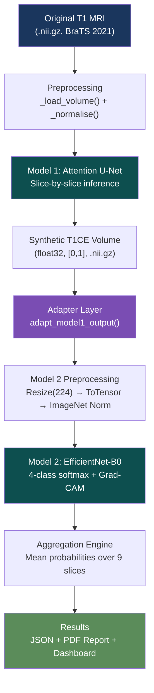
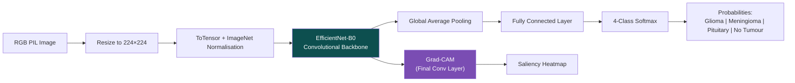
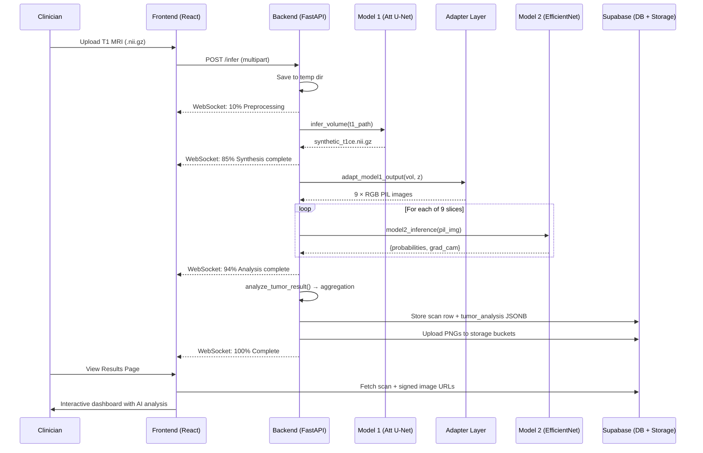

<div align="center">

# AI Architecture — NoDye

### Two-Stage Deep Learning Pipeline for Contrast-Free Brain MRI Synthesis & Tumour Classification

</div>

---

## 1. Executive Summary

NoDye employs a **two-stage, sequential deep-learning pipeline** to eliminate the need for gadolinium-based contrast agents in brain MRI:

1. **Stage 1 — Contrast Synthesis**: An Attention U-Net generates a synthetic contrast-enhanced T1 (T1CE) volume from a standard T1 MRI scan.
2. **Stage 2 — Tumour Classification**: An EfficientNet-B0 classifier analyses the synthetic T1CE to screen for brain tumours, producing per-slice probabilities and Grad-CAM saliency maps.

Neither model is retrained or modified during integration. A lightweight **adapter layer** bridges the two models, converting Stage 1's float32 NIfTI output into the RGB PIL images Stage 2 was trained on.

---

## 2. Pipeline Overview



---

## 3. Model 1 — Attention U-Net (Contrast Synthesis)

### 3.1 Architecture

Model 1 is an **Attention U-Net**, a variant of the standard U-Net architecture enhanced with attention gate mechanisms. Attention gates allow the network to focus on salient features while suppressing irrelevant regions, making it particularly effective for medical image synthesis tasks.

The generator was trained using an adversarial framework (GAN) where:
- The **generator** learns to synthesise realistic T1CE slices from T1 input.
- The **discriminator** enforces perceptual realism.

### 3.2 Input / Output Contract

| Property | Specification |
|---|---|
| **Input** | Single axial slice of a T1 MRI, normalised to [0, 1] |
| **Output** | Synthetic T1CE slice, float32, intensity range [0, 1] |
| **Processing** | Slice-by-slice across the entire 3D volume |
| **Checkpoint** | `generator_epoch0100.h5` (Keras/HDF5 format) |
| **Framework** | PyTorch (loaded via `train.py::load_generator`) |

### 3.3 Inference Flow

```python
# Simplified inference pipeline (see infer.py::infer_volume)
volume = nibabel.load(t1_path)           # Load 3D NIfTI
normalised = _normalise(_load_volume())  # Normalise to [0, 1]

for z in range(depth):
    slice_tensor = resize(normalised[:, :, z], [256, 256])
    synthetic_slice = generator(slice_tensor)   # Forward pass
    output_volume[:, :, z] = synthetic_slice    # Reconstruct 3D

nibabel.save(output_volume, "synthetic_t1ce.nii.gz")
```

### 3.4 Validation Metrics

Model 1's synthesis quality is validated against ground-truth T1CE volumes from the BraTS 2021 dataset:

| Metric | Value | Interpretation |
|---|---|---|
| **PSNR** | 32.4 dB | Peak Signal-to-Noise Ratio — higher is better; >30 dB indicates high fidelity |
| **SSIM** | 0.912 | Structural Similarity Index — ranges [0, 1]; >0.90 indicates excellent structural preservation |
| **MAE** | 0.041 | Mean Absolute Error — lower is better; <0.05 indicates minimal per-pixel deviation |

These benchmark metrics are used as defaults when no ground-truth T1CE is available for comparison. When a matched T1CE volume is provided, live metrics are computed using `evaluate_patient_scan()`.

### 3.5 Attention Heatmap

An **absolute difference map** is generated between the input T1 and the output synthetic T1CE to visualise where the model introduced the most change — effectively highlighting regions where contrast enhancement was synthesised.

---

## 4. Adapter Layer — Bridging Model 1 to Model 2

The adapter layer is a critical integration component that converts Model 1's output format into Model 2's expected input format. This is implemented in `tumor_service.py::adapt_model1_output()`.

### 4.1 The Problem

| Property | Model 1 Output | Model 2 Input |
|---|---|---|
| **Dimensionality** | 3D volume (H × W × D) | 2D image (224 × 224) |
| **Data type** | float32 | uint8 |
| **Channels** | Single-channel (grayscale) | 3-channel (RGB) |
| **Range** | [0, 1] | [0, 255] |
| **Format** | NumPy array in NIfTI | PIL Image |

### 4.2 The Solution

```python
def adapt_model1_output(vol: np.ndarray, z: int) -> PIL.Image:
    slice = np.clip(vol[:, :, z], 0.0, 1.0)     # 1. Clip to valid range
    uint8 = np.rot90((slice * 255.0).astype(np.uint8))  # 2. Scale to [0,255] + orient
    return Image.fromarray(uint8).convert("RGB")  # 3. Grayscale → RGB PIL
```

### 4.3 Design Principles

- **No intensity manipulation**: The adapter applies only clipping and linear scaling — no contrast stretching, histogram equalisation, or other transforms that could alter the diagnostic signal.
- **Orientation consistency**: The `rot90` operation ensures the classifier sees the same orientation the clinician sees in the preview image.
- **Grayscale replication**: The single channel is replicated to three RGB channels, which is exactly what Model 2's own `tumor_detector.py` does for grayscale inputs.

---

## 5. Model 2 — EfficientNet-B0 (Tumour Classification)

### 5.1 Architecture

Model 2 is an **EfficientNet-B0** classifier trained via transfer learning. EfficientNet uses a compound scaling method that uniformly scales network width, depth, and resolution, achieving state-of-the-art accuracy with significantly fewer parameters than competing architectures.



### 5.2 Classification Classes

| Class | Key | Description |
|---|---|---|
| **Glioma Tumour** | `glioma_tumor` | Arises from glial cells; most common primary intra-axial brain tumour (WHO Grade I–IV) |
| **Meningioma Tumour** | `meningioma_tumor` | Arises from the meninges; typically extra-axial, slow-growing, and most often benign (WHO Grade I) |
| **Pituitary Tumour** | `pituitary_tumor` | Arises in the pituitary gland at the sella turcica; usually benign adenomas |
| **No Tumour** | `no_tumor` | No tumour class predicted — scan appears healthy |

### 5.3 Validation Metrics

| Metric | Value |
|---|---|
| **Validation F1 Score** | **0.9745** |
| **Validation Accuracy** | **0.9721** |
| **Training Data** | BraTS / Kaggle Brain Tumor MRI Dataset |
| **Input Resolution** | 224 × 224 pixels |
| **Normalisation** | ImageNet mean & standard deviation |

### 5.4 Grad-CAM Visualisation

**Gradient-weighted Class Activation Mapping (Grad-CAM)** is applied to the final convolutional layer of the EfficientNet backbone. This produces a saliency heatmap that highlights regions of the image that most influenced the classifier's prediction.

Three visualisation panels are generated per analysed slice:

| Panel | Description |
|---|---|
| **Generated MRI** | The adapted 2D slice as seen by Model 2 |
| **Grad-CAM Heatmap** | Activation intensities overlaid on a colour scale |
| **AI Overlay** | The heatmap blended with the original MRI for spatial context |

> **Important**: Grad-CAM maps indicate model attention, not tumour boundaries. They are saliency maps, not segmentation masks.

---

## 6. Slice Selection & Aggregation

### 6.1 Slice Selection Strategy

Model 2 is a 2D classifier and cannot process an entire 3D volume at once. The system selects **9 evenly spaced axial slices** within the range of non-zero (generated) slices, always including the centre slice.

```python
def select_analysis_slices(vol, count=9):
    lo, hi = generated_slice_range(vol)  # Skip empty border slices
    indices = np.linspace(lo, hi, num=count)
    # Ensure centre slice is always included
    centre = vol.shape[2] // 2
    if centre not in indices:
        nearest = argmin(|indices - centre|)
        indices[nearest] = centre
    return sorted(set(indices))
```

### 6.2 Volume-Level Aggregation

Per-slice softmax probabilities are aggregated into a single volume-level summary:

| Aggregation | Method |
|---|---|
| **Mean probability per class** | Arithmetic mean of softmax outputs across all analysed slices |
| **Max probability per class** | Maximum softmax output observed across all slices |
| **Votes per class** | Number of slices where a given class had the highest probability |
| **Overall tumour chance** | `1 - mean(P(no_tumor))` — probability that any tumour is present |
| **Primary finding** | The class with the highest mean probability |
| **Tumour detected** | `True` if the primary finding is a tumour class |

### 6.3 Risk Tier Classification

The overall tumour chance is stratified into human-readable tiers:

| Probability Range | Tier Label |
|---|---|
| ≥ 50% | High Chance |
| 15% – 49% | Medium Chance |
| 3% – 14% | Low Chance |
| < 3% | Very Low Chance |

For the "No Tumour" class specifically, the tier is always labelled **"Healthy / No Tumour"** regardless of the raw probability, ensuring clinically sensible communication.

---

## 7. End-to-End Data Flow



---

## 8. Model Limitations & Transparency

| Capability | Status | Notes |
|---|---|---|
| Tumour detection (binary) | ✅ Supported | Based on aggregate class probabilities |
| Tumour type classification | ✅ Supported | 4-class classifier with F1 = 0.9745 |
| Grad-CAM saliency maps | ✅ Supported | Highlights influential regions (not boundaries) |
| Tumour segmentation mask | ❌ Not available | Model 2 is a classifier, not a segmentation model |
| Tumour volume measurement | ❌ Not available | Requires a segmentation mask |
| Anatomical location | ❌ Not available | Grad-CAM shows attention, not coordinates |
| Clinical diagnosis | ❌ Not available | All results must be reviewed by a qualified radiologist |

---

## 9. Technical Environment

| Component | Technology | Version |
|---|---|---|
| Deep Learning Framework | PyTorch | 2.x |
| Model 1 Weights Format | Keras HDF5 (`.h5`) | — |
| Model 2 Weights Format | PyTorch checkpoint (`.pth`) | — |
| Inference Device | CPU / CUDA (auto-detected) | — |
| Medical Imaging I/O | NiBabel | 5.x |
| Image Processing | OpenCV, Pillow, NumPy | — |
| Grad-CAM | Custom implementation (`src/interpret.py`) | — |

---

<div align="center">
<sub>NoDye AI Architecture · HackSpectra HS020 · 2026</sub>
</div>
