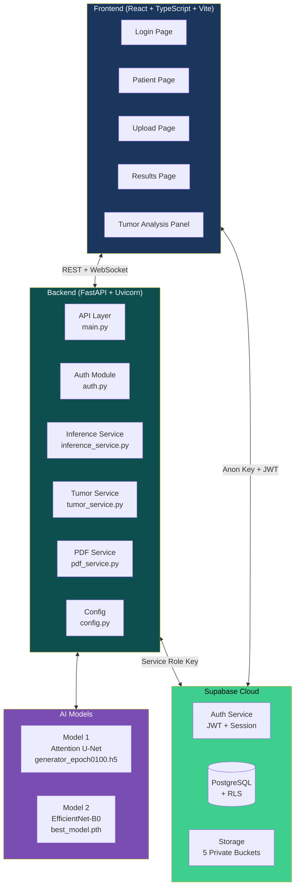
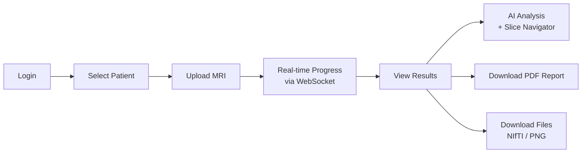
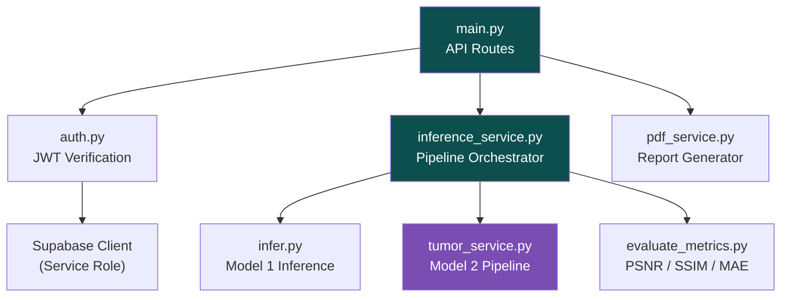
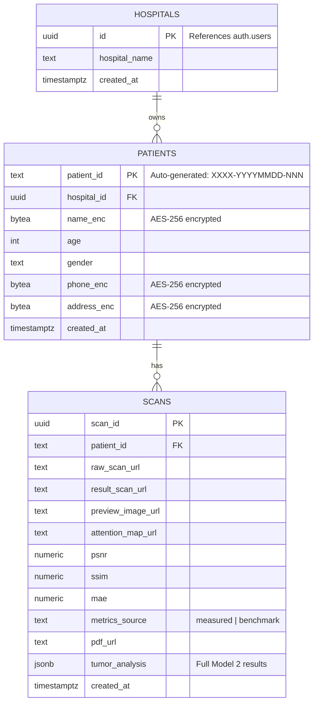
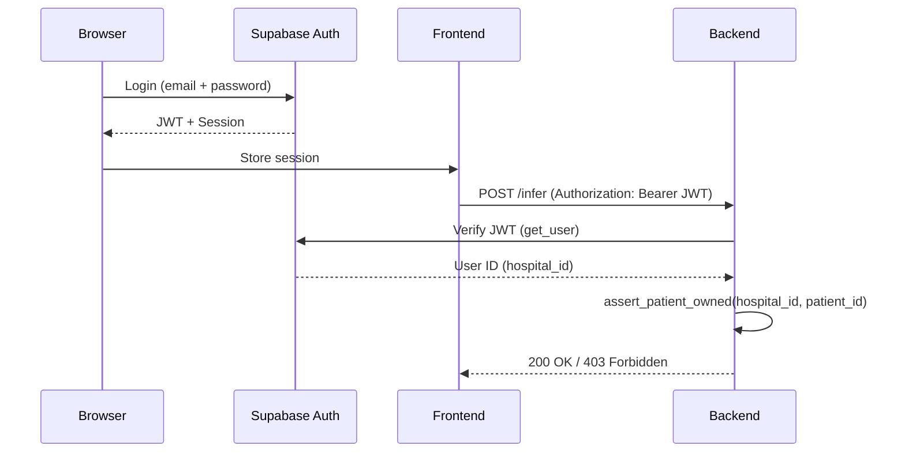

<div align="center">

# System Architecture — NoDye

### Full-Stack Clinical AI Platform for Contrast-Free Brain MRI

</div>

---

## 1. High-Level Architecture

NoDye is a **full-stack, multi-tenant SaaS platform** built for hospital radiology departments. It combines a React frontend, a FastAPI backend with two deep-learning models, and Supabase for authentication, database, and object storage.



---

## 2. Frontend Architecture

### 2.1 Technology Stack

| Technology | Purpose |
|---|---|
| **React 18** | UI component framework |
| **TypeScript 5** | Type-safe development |
| **Vite** | Build tool and dev server |
| **Vanilla CSS** | Custom design system (no Tailwind) |
| **Supabase JS Client** | Auth, database queries, storage signed URLs |

### 2.2 Page Structure

```
frontend/src/
├── pages/
│   ├── LoginPage.tsx          # Supabase Auth login
│   ├── PatientPage.tsx        # Patient registration + list
│   ├── UploadPage.tsx         # MRI upload + WebSocket progress
│   └── ResultsPage.tsx        # Scan results + AI analysis
├── components/
│   ├── TumorAnalysisPanel.tsx # Interactive AI results viewer
│   ├── ImagePanel.tsx         # Zoomable medical image viewer
│   ├── FindingCard            # AI finding summary badge
│   ├── CategoryTable          # Tumour type breakdown table
│   └── SliceNavigator         # Interactive slice stepper
├── hooks/
│   └── useWebSocket.ts       # Real-time inference progress
└── lib/
    └── supabase.ts            # Client init + domain types
```

### 2.3 Key User Flows



### 2.4 Real-Time Progress

The upload page establishes a **WebSocket connection** (`/ws/infer/{task_id}`) that streams progress events from the backend:

| Progress | Stage |
|---|---|
| 2% | Upload received |
| 10% | Preprocessing complete |
| 15–85% | Synthesising contrast (per-slice updates) |
| 86% | Extracting attention heatmap |
| 88–94% | AI tumour analysis (per-slice) |
| 95% | Computing metrics |
| 98% | Uploading to storage |
| 100% | Complete |

---

## 3. Backend Architecture

### 3.1 Technology Stack

| Technology | Purpose |
|---|---|
| **FastAPI** | Async web framework |
| **Uvicorn** | ASGI server |
| **PyTorch** | Deep learning inference |
| **NiBabel** | Medical imaging I/O (NIfTI) |
| **ReportLab** | PDF report generation |
| **supabase-py** | Server-side Supabase client (service role) |

### 3.2 API Endpoints

| Method | Endpoint | Purpose |
|---|---|---|
| `GET` | `/health` | Server status, model availability, device info |
| `POST` | `/infer` | Upload MRI + trigger full pipeline (returns `task_id`) |
| `WS` | `/ws/infer/{task_id}` | Real-time progress stream |
| `GET` | `/scans/{scan_id}/pdf` | Generate and download clinical PDF report |

### 3.3 Service Layer



**`inference_service.py`** is the central orchestrator. A single call to `run_inference_job()` executes the entire pipeline:

1. Save uploaded bytes to a temp directory
2. Run Model 1 (`infer_volume`) to produce `synthetic_t1ce.nii.gz`
3. Generate preview PNG and attention heatmap
4. Run Model 2 (`tumor_service.run_tumor_analysis`) on the synthetic T1CE
5. Compute image quality metrics (PSNR, SSIM, MAE)
6. Upload all artefacts to Supabase Storage
7. Insert scan record + tumor analysis into the database

### 3.4 Error Isolation

Model 2 failures are **never allowed to abort the Model 1 pipeline**. If the tumour classifier crashes or is unavailable, the scan is still saved with a `tumor_analysis.status = "failed"` marker. This ensures the core contrast synthesis functionality is always available.

---

## 4. Database Architecture

### 4.1 Schema



### 4.2 Security: Row Level Security (RLS)

Every table has RLS policies that enforce **strict hospital-level data isolation**:

| Table | Policy | Rule |
|---|---|---|
| `hospitals` | `hospital_self` | Hospital can only read its own row |
| `patients` | `hospital_isolation_patients` | All operations scoped to `hospital_id = auth.uid()` |
| `scans` | `hospital_isolation_scans` | Accessible only if the scan's patient belongs to the authenticated hospital |

### 4.3 PII Encryption

Patient Personally Identifiable Information (name, phone, address) is encrypted at rest using **AES-256 symmetric encryption** via PostgreSQL's `pgcrypto` extension. The encryption key is stored in Supabase Vault and never exposed to the frontend.

| Field | Storage | Encryption |
|---|---|---|
| Name | `name_enc` (bytea) | `pgp_sym_encrypt(value, vault_key, 'cipher-algo=aes256')` |
| Phone | `phone_enc` (bytea) | Same |
| Address | `address_enc` (bytea) | Same |
| Age, Gender | Plaintext | Not PII-sensitive |

### 4.4 RPC Functions

| Function | Access | Purpose |
|---|---|---|
| `register_patient()` | Authenticated users | Create patient with encrypted PII |
| `get_my_patients()` | Authenticated users | List + decrypt own patients |
| `get_patient_for_hospital()` | Service role only | Decrypt one patient for PDF generation |
| `generate_patient_id()` | Internal | Auto-generate structured patient IDs |

---

## 5. Storage Architecture

All files are stored in **Supabase Storage** across five private buckets:

| Bucket | Contents | Access |
|---|---|---|
| `raw-scans` | Original uploaded T1 NIfTI files | Hospital-scoped read; service-role write |
| `result-scans` | Synthetic T1CE NIfTI files | Same |
| `previews` | Central slice preview PNGs | Same |
| `heatmaps` | Attention maps + Model 2 per-slice PNGs | Same |
| `reports` | Generated PDF reports | Same |

### Object Path Convention

All objects follow a hierarchical key structure:

```
{hospital_uid}/{patient_id}/{scan_id}/{filename}
```

This structure enables the RLS storage policy to enforce that hospitals can only read objects under their own UID prefix.

---

## 6. Authentication & Authorisation



| Layer | Mechanism |
|---|---|
| **Authentication** | Supabase Auth (email/password) |
| **Token Format** | JWT (passed as `Authorization: Bearer` header) |
| **Backend Verification** | `auth.py::verify_user()` validates JWT via Supabase API |
| **Authorisation** | Ownership checks + RLS policies |
| **Multi-tenancy** | Each hospital is a Supabase Auth user; RLS isolates all data |

---

## 7. PDF Report Generation

Clinical PDF reports are generated on-demand using **ReportLab** and include:

| Section | Contents |
|---|---|
| **Header** | Hospital name + NoDye branding |
| **Patient Details** | Decrypted patient ID, name, age, gender |
| **Imaging** | Synthetic T1CE preview + attention heatmap |
| **AI Tumor Analysis** | Finding card, tumour type breakdown table, AI summary |
| **Footer** | Physician signature line |

Reports are simultaneously returned to the browser and uploaded to the `reports` storage bucket.

---

## 8. Deployment Architecture

```
┌─────────────────────────────────────────────────┐
│                   Client Browser                 │
│            (React SPA, Vite dev server)          │
└─────────────────┬───────────────────────────────┘
                  │ HTTP/WS (localhost:5173 → :8000)
┌─────────────────▼───────────────────────────────┐
│              FastAPI + Uvicorn                    │
│         (localhost:8000, --reload)                │
│  ┌──────────────────────────────────────────┐    │
│  │  In-Process Models (CPU/CUDA)            │    │
│  │  • Attention U-Net (.h5)                 │    │
│  │  • EfficientNet-B0 (.pth)               │    │
│  └──────────────────────────────────────────┘    │
└─────────────────┬───────────────────────────────┘
                  │ HTTPS (service-role key)
┌─────────────────▼───────────────────────────────┐
│              Supabase Cloud                      │
│  • Auth (JWT sessions)                           │
│  • PostgreSQL + RLS + Vault                      │
│  • Storage (5 private buckets)                   │
└─────────────────────────────────────────────────┘
```

---

## 9. Technology Stack Summary

| Layer | Technology |
|---|---|
| **Frontend** | React 18, TypeScript 5, Vite, Vanilla CSS |
| **Backend** | FastAPI, Uvicorn, Python 3.10+ |
| **ML — Model 1** | PyTorch, Keras Attention U-Net, NiBabel, NumPy |
| **ML — Model 2** | PyTorch, EfficientNet-B0, Grad-CAM, Pillow |
| **Database** | PostgreSQL (Supabase) with RLS + pgcrypto |
| **Storage** | Supabase Storage (private buckets, signed URLs) |
| **Auth** | Supabase Auth (JWT, per-hospital isolation) |
| **PDF** | ReportLab |
| **Real-time** | WebSockets (native FastAPI) |

---

<div align="center">
<sub>NoDye System Architecture · 2026</sub>
</div>
